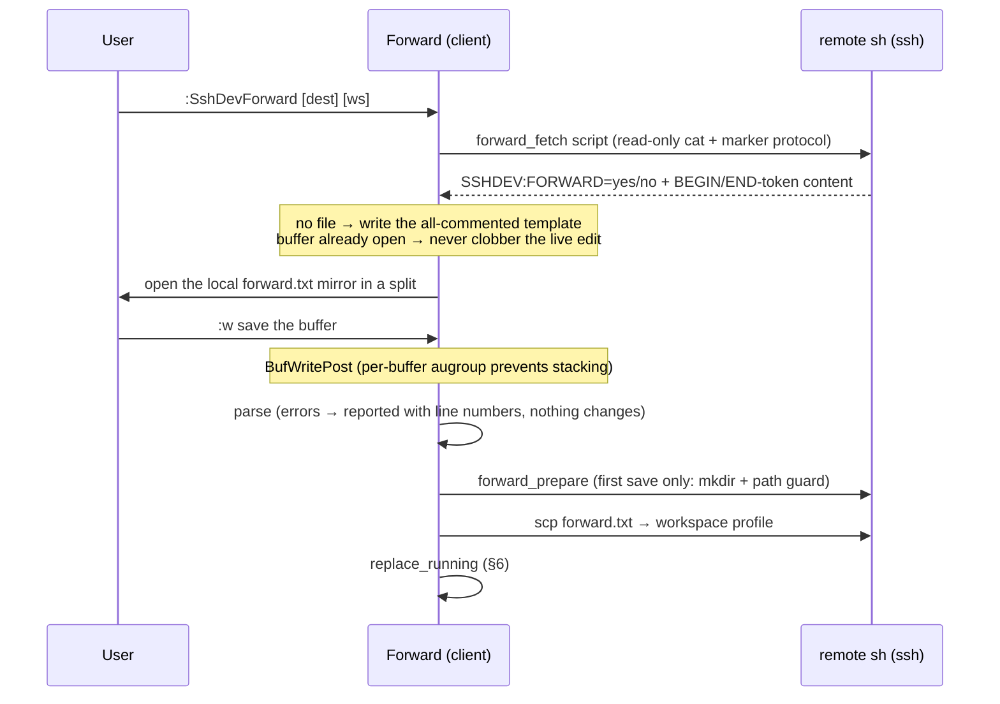

# sshdev.nvim Port Forwarding — Technical Documentation

This document describes the complete technical implementation of the
**port forwarding** subsystem in sshdev.nvim: the internal session tunnel
the plugin itself communicates through, and the user-defined forwards
declared via `:SshDevForward` and driven by `forward.txt` — the file
protocol, tunnel spawning and verification, failure rollback, and the
cooperation over the RPC control channel when forwards are edited inside
an attached session.

The connection itself (destination parsing, authentication, server
startup, attaching) is covered in the companion document
[docs/remote-connection.md](remote-connection.md).

---

## 1. Overview: two independent tunnels

sshdev.nvim maintains **two kinds** of local forward tunnels, both spawned
by `lua/sshdev/ssh.lua` and both running as detached `ssh -N` processes:

|  | Session tunnel (internal) | User forward tunnel (forward.txt) |
| --- | --- | --- |
| Purpose | carry local UI/control-channel RPC to the remote nvim server | map remote (or remote-reachable) service ports onto the local machine |
| Declaration | automatic: one deterministic port pair per `(destination, workspace)` | manual: `<workspace-profile>/forward.txt`, one forward per line |
| Shape | a single `-L 127.0.0.1:<lport> → 127.0.0.1:<rport>` | one `ssh -N` process carrying one `-L` per line |
| Lifecycle | managed by the connect pipeline (created/reused on connect, killed on teardown) | replaced as a unit whenever forward.txt is saved; killed by `:SshDevStop` / nvim exit |
| Port source | `20000 + djb2('L:…') % 20000` (within [20000, 39999]) | user-declared local ports (must be free) |

```text
local machine                                remote host (dest)
──────────                                  ──────────────
127.0.0.1:<lport> ──┐
                    │ session tunnel (ssh -N -L)     nvim --headless
                    └──────────────────────────►    --listen 127.0.0.1:<rport>

127.0.0.1:3080 ─────┐
127.0.0.1:8080 ─────┤ user forward tunnel (one ssh -N,
                    │ one -L per line)              workspace profile
                    └──────────────────────────►    forward.txt (source of truth)
                                                     127.0.0.1:3080
                                                     127.0.0.1:8080
```

Both tunnels use identical process options (see §2); they differ only in
where the `-L` specs come from and when they are replaced. All
forwarding logic lives in `lua/sshdev/forward.lua`.

---

## 2. Tunnel process implementation (ssh.lua)

### 2.1 Argument shape

`Ssh.start_tunnel` (session tunnel) and `Ssh.start_forwards` (user
forwards) ultimately spawn this argv:

```text
ssh <base args> [-p port]
    -N
    -L 127.0.0.1:<lport>:127.0.0.1:<rport>            # session tunnel: single
    -L 127.0.0.1:<lport>:<rhost>:<rport>  …(one per line)  # user forwards: many
    -o ControlMaster=no
    -o ExitOnForwardFailure=yes
    -- <user@host>
```

`base args` is the common base of every ssh call: `ConnectTimeout=15`,
`ServerAliveInterval=15`, `ServerAliveCountMax=3`,
`StrictHostKeyChecking=accept-new`, the optional `-p`, `BatchMode=yes`
when applicable (auto mode with no cached password yet), and the user's
`ssh_args` appended last (the full table is in
[remote-connection.md](remote-connection.md) §5.1).

The two tunnel-specific options each have an explicit rationale:

| Option | Rationale |
| --- | --- |
| `ControlMaster=no` | connection multiplexing is explicitly disabled. A multiplexed tunnel would die together with a short-lived ControlPersist master; these processes must live as long as the remote session does |
| `ExitOnForwardFailure=yes` | any local bind failure (busy port, a Windows reserved range, rejected auth) kills the whole process instead of silently dropping that one forward — this is what makes every "dead" verdict below trustworthy |
| `-N` | no remote command, no session; pure forwarding |

### 2.2 Detached process and handle

`spawn_detached_tunnel()` spawns via
`jobstart(args, { detach = true, env, … })`: **detachment is mandatory** —
the default attach (`:connect`) detaches the local nvim server (it keeps
running headless), and the tunnel must not die with it. When a password is
cached, `env` injects the askpass triple (`SSH_ASKPASS` /
`SSH_ASKPASS_REQUIRE=force` / `SSHDEV_PASS`) so even a terminal-less
detached process authenticates (verified on Windows OpenSSH 9.5).

With `reconnect = true` the session's UI tunnel is owned by the local
reconnect relay instead (`lua/sshdev/proxy.lua`, `scripts/ui_proxy.lua`),
which spawns the same `ssh -N -L` argv plus the control forward and rebuilds
it on a network drop. The forwards described in this document are a
*separate* tunnel and are re-applied by the control keeper after a reconnect
(see [remote-connection.md](remote-connection.md) §8.6).

The returned handle:

```lua
{
  job,             -- jobstart id (used only to kill)
  alive,           -- set false by on_exit
  exit_code,       -- recorded by on_exit
  kill(),          -- jobstop + state cleanup
  stderr_tail(),   -- last 8 lines of the ring buffer (20 lines kept)
  dest, specs / lport, rport,   -- caller-supplied metadata
}
```

`on_stderr` appends every line to the ring buffer and mirrors it into
`:SshDevLog` (prefixed `[tunnel]`); `on_exit` records the code and, on a
non-zero exit whose stderr carries the auth-failure signature, drops the
cached password (the next connection asks again).

### 2.3 The two TCP probe primitives — the semantic difference is the key

`lua/sshdev/proc.lua` provides two probes that look similar but are
deliberately different:

| Primitive | Verdict | Used for |
| --- | --- | --- |
| `await_tcp_probe(host, port, settle_ms, timeout)` | the connection must succeed **and stay stable for `settle_ms`** (EOF/error during the window counts as dead) | probing the session tunnel: an `ssh -L` forward accepts locally even when the remote target refuses and only then EOFs — "connected and still alive" is the only trustworthy signal |
| `await_tcp_accept(host, port, timeout)` | **connect success only** | probing whether the forward tunnel is installed: we only care that ssh has put its local listeners in place (whether the remote target works is the user's concern) |

Mixing them up is the most subtle bug source in forward verification:
adding a settle window to the accept probe would race the remote
round-trip EOF; removing the settle window from the session probe gets
fooled by "locally accepted but refused remotely". The source comments
call this out explicitly.

---

## 3. The session tunnel

### 3.1 Port selection and reuse

- The base local port is
  `lbase = 20000 + djb2('L:' .. user@host .. '/' .. ws-key) % 20000` —
  deterministic and unique per `(destination, workspace profile)`
  (`user@host` without the ssh port); the remote `rport` uses the sister
  formula with the `'R:'` prefix, and the server start occupies
  `rbase..rbase+2` one after another.
- `run_attach` first probes the existing tunnel at `lbase` with
  `await_tcp_probe('127.0.0.1', lbase, 400, 2000)`: a detached process
  left behind by a previous nvim instance that is still serving gets
  reused — no second tunnel is spawned.
- When the probe fails, a free port is searched upward from `lbase`
  (`pick_local_port`, at most 16 candidates). A busy base port is logged
  verbatim: "port X is busy; the new tunnel uses Y".

### 3.2 Waiting for readiness and failure reporting

After spawning, the flow polls
`await_tcp_probe('127.0.0.1', lport, 300, 1500)` within
`timeouts.attach` (default 30s):

- the tunnel process dies → immediate failure, the error carrying the
  exit code and ssh's own stderr tail;
- the deadline passes → the self-started tunnel is killed and the error
  points at the remote `<workspace-profile>/server.log` and
  `:SshDevLog`.

Only once the tunnel is confirmed reachable does the flow open the RPC
control channel, (asynchronously) replay the user forwards, and attach
the UI (see [remote-connection.md](remote-connection.md) §4 and §8).

### 3.3 Lifecycle

- Only a tunnel **started by this instance** is held (`state.tunnel`);
  a reused tunnel is neither registered nor killed.
- `VimLeavePre → teardown_local()`: kill the session tunnel, close the
  control channel, stop the user forwards; **exception**: right after a
  successful `:connect` (`state.attached`) the teardown is skipped —
  the local server is detached and keeps running headless, the tunnel must
  survive, and the remote server keeps running.
- With `reconnect = true`, a network drop kills this forwards tunnel too; the
  control keeper re-opens the channel through the relay's rebuilt tunnel and
  re-applies `forward.txt` automatically (remote-connection.md §8.6).
- `:SshDevStop`: explicitly kills the tunnel (plus the control channel
  and user forwards) and `SIGTERM`s the remote server (saving the
  session).

---

## 4. forward.txt: the user-forward declaration file

### 4.1 Location and role

```text
Remote (source of truth):
  <remote_root>/workspace-profiles/--<host>--<ws-path>--/forward.txt

Local (editing medium only, a mirror):
  <stdpath('cache')>/sshdev/forward/<workspace-profile-key>/forward.txt
```

The truth lives in the **remote workspace profile**: any nvim instance
reopening `:SshDevForward` reads the same file, and it is replayed
automatically on every connect via `forward_on_connect`. The local copy
is only the on-disk medium for the editing buffer; every save re-uploads
the edited result back to the remote. The mirror directory key (the
workspace profile key) is validated to be a single path segment, ruling
out directory escape.

### 4.2 Line format and semantics

```text
# one forward per line:  <local-port> = <remote-host>:<remote-port>
3080 = 127.0.0.1:3080
5432 = db.internal:5432
```

- The **local port** binds on this machine's `127.0.0.1` (loopback only,
  never exposed);
- the **target address is resolved on the server**: `127.0.0.1:3080`
  means the server's own loopback; `db.internal:5432` is reachable only
  from the server — the right way to bring remote-only internal services
  back to your desk;
- `#`-lines and blank lines are ignored; an **empty file stops all
  forwards**.

### 4.3 Parse validation (`Forward.parse`, a pure function)

All errors are collected line by line (with line numbers); **any single
error means nothing is applied**:

| Check | Behavior |
| --- | --- |
| Format `^(%d+)%s*=%s*([%w%.%-_]+):(%d+)$` | mismatch → `line N: expected "<local-port> = <remote-host>:<remote-port>", got: …` |
| Local/remote port range 1–65535 | out of range reported individually |
| Duplicate local port | reported with the line number of its first occurrence |
| Remote host charset `[A-Za-z0-9._-]` (hostname / IPv4 literal) | **IPv6 literals are not supported** (the same known limitation as destination parsing) |
| Leading/trailing whitespace / `\r` | tolerated (CRLF files parse with LF semantics) |

### 4.4 The initial template

When the remote has no `forward.txt`, `:SshDevForward` writes an
**all-commented** template (destination and workspace header comments
plus example lines): `parse(template) == { } / { }`, so saving the
template never accidentally opens a forward. The remote-side template
(§7) omits the destination line — the remote does not know the client's
connection string.

---

## 5. The local editing flow (`:SshDevForward` → save)



Details:

- **No-argument fast path**: the active session already knows the
  workspace profile — no probing round trip. With arguments the
  destination is resolved exactly like a connect (probe + layout).
  Inside an attached session the command actually runs in the **remote
  nvim** (`SSHDEV_REMOTE=1`), and `session.forward()` dispatches to the
  remote-side flow (§7) — transparent to the user.
- **The fetch marker protocol**: `forward_fetch` returns the file
  content between `SSHDEV:BEGIN-<token>` and `SSHDEV:END-<token>`,
  where the token is freshly generated each call — content that happens
  to look like a marker cannot confuse the extraction. Transport
  realities are absorbed in `extract_content`: `Proc.await` drops empty
  lines (semantically void to the parser anyway), a trailing bare `\r`
  is stripped (CRLF normalization), and a remote file lacking a trailing
  newline gains one (`:w` writes one regardless).
- **Never clobber a live edit**: when a buffer for the file is already
  open, its unsaved content is kept and the buffer is only refocused; a
  failed fetch is treated as "file missing", and the next save runs the
  idempotent `forward_prepare` before uploading.
- **The save hook**: one augroup per buffer
  (`sshdev-forward-<bufnr>`), so re-running `:SshDevForward` *replaces*
  the autocmd instead of stacking another one. Window policy: focus an
  existing window showing the buffer, otherwise open a split.
- **Upload**: `Ssh.upload_file` runs scp with a relative source path +
  `cwd` (avoiding the Windows `C:` ambiguity; the remote path is passed
  unquoted — SFTP semantics, quoting it would fail). `forward_prepare`
  first ensures the workspace profile directory exists and refuses to
  write `forward.txt` anywhere outside `workspace-profiles/` (a `case`
  guard in the script, same standard as `Scripts.prepare`).
- After every open the buffer variable `sshdev_forward`
  (`dest` / `workspace`) is set for statuslines and debugging.

---

## 6. Replacing the running forwards (replace_running + await_up)

The last step of `Forward.apply` is an **atomic replace**: validate
first, kill the old, start the new, verify, roll back on failure. The
function is shared by the local save flow (`M.apply`) and the
remote-triggered flow (`M.apply_remote`); only the reporting target
differs (local notification vs. the control channel).

### 6.1 Busy-port pre-check

Before killing the old tunnel, every local port is checked:

- a port held by **our own live tunnel** (the old specs contain the same
  `lport`) is expected — the kill below frees it;
- any other port held by a foreign process (often an ssh left behind by
  a crashed nvim) fails the whole operation **with the old forwards
  still running**, and the error suggests `ss -ltn` / `netstat -an` to
  hunt down the leftover process.

Note this check is best-effort only: on Windows libuv binds with
`SO_REUSEADDR` and succeeds even over a foreign listener — the
**authoritative verdict is the verified wait in §6.2**, which catches
whatever ssh genuinely could not bind.

### 6.2 The verification wait (await_up)

`ExitOnForwardFailure` turns a bind failure into "the process exited",
and that happens only **after** ssh finished authenticating — a fixed
sleep cannot reliably distinguish "still authenticating" from "already
dead". The verification is therefore a state machine:

```text
deadline = now + timeouts.attach (default 30s)
loop:
    applied ≠ handle      → 'stale'   (a newer flow took the state over; bow out silently)
    handle.alive == false → 'dead'
    await_tcp_accept(127.0.0.1, first_port, 800ms) succeeded:
        watch for a further 1500ms grace window (150ms steps)
        process died during it → 'dead'; survived → 'up'
    otherwise sleep 200ms and retry
timeout: process dead → 'dead'; otherwise → 'timeout'
```

The grace window exists because the accept probe can be fooled by a
**foreign process** already listening on the port (notably on Windows),
while real bind failures land right after authentication, immediately
next to the accept — "accepted a connection *and* survived another
1.5s" is the only combination trusted as success. Probing a single port
is sufficient: ssh installs all `-L` listeners as one unit and exits
instead of binding a partial set (`ExitOnForwardFailure`), so a
"half-installed" forward set cannot exist.

### 6.3 The four verdicts

| Verdict | Handling |
| --- | --- |
| `up` | log + notify "forwards applied (dest): 3080 -> …". **Then keep watching for another 10 seconds**: a very slow link can deliver the bind failure only after the probe and its grace window passed — the verdict is then corrected (rollback + ssh's own stderr) |
| `timeout` | not answering but not dead (very slow link): the tunnel stays running and registered, a WARN points at `:SshDevStatus`, which tells the truth either way |
| `dead` | definitive failure: `rollback` restores the previous forward set, an ERROR reports the exit code + ssh's stderr tail |
| `stale` | a newer save / `:SshDevStop` / nvim exiting took the state over: this flow bows out silently (its handle was killed by whoever took over) |

### 6.4 Rollback

This save already killed the old tunnel, so a `dead` verdict must
**bring the previous set back**:

- conditions: an old handle exists, it was alive when this save started,
  its specs are non-empty, and nobody else has taken over
  (`applied == nil`);
- the old specs are restarted and go through the same `await_up`
  verification;
- `up` → notify "previous forwards restored: …" (WARN level, so the
  user knows the new configuration did *not* take effect); `dead` → the
  log records that the old set could not restart either;
  `stale`/`timeout` → yield / stay registered, the status tells the
  truth.

Error-propagation summary: **parse errors** — nothing changes (the
remote file and the running forwards are untouched); **busy ports** —
the old forwards keep running; **dead new tunnel** — the previous set is
best-effort restored. There is no half-applied intermediate state.

---

## 7. Editing inside an attached session (remote side + control channel)

With the default `attach = 'auto'`, `:SshDevForward` runs inside the
**remote nvim** (the UI is attached there, so typed commands execute
there). That creates a structural problem:

> forward.txt lives on the remote (editing it is a local file
> operation), but the forward ports must bind on the **client** machine
> — only the client can start the tunnel.

The solution is the RPC control channel described in
`remote-connection.md` §8.4:

```mermaid
sequenceDiagram
    participant RU as remote nvim (attached UI)
    participant U as User
    participant CH as control channel (rpcnotify → nvim_exec_lua)
    participant CU as client nvim (headless)

    RU->>RU: Forward.open_remote($SSHDEV_WORKSPACE_PROFILE)
    Note over RU: checks _G.SSHDEV_CONTROL_CHANNEL;<br/>local file — creating the template needs no ssh
    RU->>U: open the remote forward.txt for editing
    U->>RU: :w
    RU->>CH: rpcnotify → nvim_exec_lua<br/>"require('sshdev.session')._remote_forward_apply(profile)"
    CH->>CU: runs apply_remote in a client coroutine
    Note over CU: the remote file already IS the truth → no upload;<br/>fetch → refresh the local mirror → parse → replace_running
    CU->>CH: outcome rpcnotify → vim.notify ([sshdev] prefixed)
    CH->>RU: the outcome shows up in the attached UI
```

Key points (source: `forward.lua` / `session.lua`):

- **open_remote guards**: `$SSHDEV_WORKSPACE_PROFILE` must be an
  absolute path; when `_G.SSHDEV_CONTROL_CHANNEL` is not a number (the
  client plugin is too old, or the announce was lost) no save hook is
  registered and the user gets the fallback guidance: `:detach` (the
  server keeps running), run `:SshDevForward` + `:w` in a new local
  nvim, then `:SshDevAttach`.
- **Every save pushes**: the BufWritePost callback **re-reads** the
  channel id each time (the client re-announces on every attach); a
  failed `pcall(rpcnotify, …)` yields the same fallback guidance. File
  creation and window opening reuse the client-side helpers (the same
  `find_buf` / `open_window`).
- **Receiving-side guard**: `session._remote_forward_apply(profile)`
  only honors a profile that **exactly matches the active session's**
  `state.info.workspace_profile` — a stale announce from an old session
  or another workspace's request is ignored and logged; executing inside
  the remote server itself is explicitly forbidden (loop prevention).
- **apply_remote vs apply**: the remote file already *is* the source of
  truth, so there is no scp upload; instead the fetched content is
  written into the local mirror, keeping a later local `:SshDevForward`
  in agreement with it. A remotely vanished file is treated as "no
  forwards".
- **Two-way reporting**: `report_remote` logs first, then
  `rpcnotify → nvim_exec_lua vim.notify` delivers the message (with the
  `[sshdev] ` prefix) into the **attached UI**; if the channel is gone
  the log is all that remains. The local flow uses `report_local`:
  ERROR goes through `Util.report_error` (log + notification), anything
  else is a plain notification.

---

## 8. Automatic replay on connect (forward_on_connect)

`setup({ forward_on_connect = true })` (the default) makes every
`:SshDevConnect` / `:SshDevAttach` **asynchronously** replay the
workspace's forwards at the end (never delaying the attach itself):

1. a read-only fetch of the remote `forward.txt` — no file, silent exit
   (zero cost);
2. the local mirror is refreshed along the way (a later local
   `:SshDevForward` therefore always agrees with the remote);
3. parse errors → a WARN suggesting `:SshDevForward` inside the session
   to fix them (nothing is applied);
4. no forwards configured → done;
5. the local ports of the specs are probed one by one: **all already
   listening** → assumed to be leftovers from the previous session,
   kept as-is with an INFO note (":SshDevForward + :w forces a
   re-apply"); otherwise `replace_running` runs, its outcome surfacing
   in the attached UI through the control channel.

The resulting workflow: connect → the forwards come back on their own;
edit the forwards → saving replaces them as a unit; a leftover tunnel
after a crashed nvim is recognized and reused on the next connect (or
cleared with a forced re-apply).

---

## 9. Lifecycle and status

Every end point of the user-forward tunnel:

| Event | Behavior |
| --- | --- |
| saving forward.txt | replaced as a unit (kill + start, one process swapped for another) |
| `:SshDevStop` | `Forward.kill()`, stopped together with the session tunnel |
| local nvim exit (`VimLeavePre`) | same; reopen `:SshDevForward` and save to re-establish, or wait for `forward_on_connect` |
| right after a successful `:connect` | `teardown_local` skips (the tunnel must survive the local server being detached) |
| a newer flow takes over (stale) | the superseded verification loop bows out silently |

The plugin is single-session: **each nvim instance holds exactly one
forward tunnel handle** (the module-level `applied` in `forward.lua`),
and "the workspace's current forwards" are always one `ssh -N` with
multiple `-L`s — which is precisely what makes the atomic replace
possible.

The forward line in `:SshDevStatus` reads
`forwards: up (3080 -> 127.0.0.1:3080, …)`, with `up/down` taken from
the handle's `alive`.

---

## 10. Commands and configuration

```vim
:SshDevForward                       " the active session's workspace (no probe, fastest)
:SshDevForward me@myhost             " explicit destination (workspace defaults/history)
:SshDevForward me@myhost ~/src/app   " fully resolved, no active session needed
```

- The command accepts the same `[dest] [workspace]` shape and completion
  as the connect commands; `--nvim-profile` is accepted but irrelevant —
  forward.txt belongs to the workspace profile, which does not depend on
  the nvim profile.
- **Inside an attached session** it transparently switches to the
  remote-side flow (§7): the file opened is the very same remote one.
- No active session and no `dest` argument → an ERROR prompting to
  connect first.

| Option | Default | Meaning |
| --- | --- | --- |
| `forward_on_connect` | `true` | replay forward.txt after connect/attach (one read-only ssh round trip; no file, no action) |
| `timeouts.attach` | `30` | the verification budget for the forward tunnel (the `await_up` deadline) |
| `ssh_args` | `{}` | appended to the tunnel ssh as well (e.g. pinning `-i`) |
| `auth` | `'auto'` | tunnel processes authenticate via askpass too (§2.2) |

---

## 11. Troubleshooting

| Symptom | Explanation | Fix |
| --- | --- | --- |
| `cannot forward: local port(s) N already in use …` | a foreign process holds the port (usually an ssh left by a crash) | hunt it down with `ss -ltn` / `netstat -an` as suggested; the old forwards keep running meanwhile |
| `the forward tunnel to … died (exit N): <ssh stderr>` | authoritative ssh failure: unbindable port, rejected auth, … | read the attached ssh stderr; a rejected password already dropped the cache, the next connect asks again |
| `the forwards … did not answer within 30s` | very slow link: not dead, not answering; the tunnel stays running | check `:SshDevStatus` for the real state; things work once the link recovers |
| `forward.txt has N invalid line(s) — nothing was applied` | parse failure (format/range/duplicate port/IPv6) | fix the reported lines and `:w` again; the remote file and running forwards were untouched |
| the forwards "disappear" after saving an empty file | intended: an empty file means "stop everything" | add the needed lines back and save |
| a save inside the attached session reports the control channel lost | the client plugin is too old / the announce was lost | follow the guidance: `:detach` → `:SshDevForward` + `:w` in a new local nvim → `:SshDevAttach` |
| `5432 = db.internal:5432` does not connect | the target resolves **on the server**: the server cannot reach db.internal, or the local port is wrong | verify from the remote with `nc -vz db.internal 5432`; check the local side with `ss -ltn` |
| the forwards do not come back after reconnecting | `forward_on_connect = false`, or every port was already listening (recognized as "kept leftovers") | force a replay with `:SshDevForward` + `:w`; check the setting |
| the forwards do not come back after a network drop | the relay is still rebuilding the tunnel, or the remote server itself stopped | wait for "reconnecting…" to finish; `:SshDevLog` shows the keeper's re-apply. If the server stopped, reconnect (`forward_on_connect` replays them) |
| the forwards vanish together with nvim | intended: `VimLeavePre` cleanup (except right after a `:connect` attach) | reconnect replays them, or save forward.txt manually |

---

## 12. Source index

| Module | Responsibility |
| --- | --- |
| `lua/sshdev/forward.lua` | forward.txt parsing/template/marker extraction, the local and remote editing flows, replace + rollback, `forward_on_connect` |
| `lua/sshdev/ssh.lua` | `start_tunnel` / `start_forwards` / `forward_tunnel_args` (pure, testable), detached tunnel spawning, `local_port_free` / `pick_local_port` |
| `lua/sshdev/proc.lua` | the `await_tcp_accept` / `await_tcp_probe` probe primitives, `sleep`, coroutine launching |
| `lua/sshdev/remote_scripts.lua` | `forward_fetch` (read-only + BEGIN/END token markers), `forward_prepare` (mkdir + path guard) |
| `lua/sshdev/session.lua` | the `forward()` entry dispatch (local/remote), the `_remote_forward_apply` receiving guard, the control channel, teardown |
| `lua/sshdev/config.lua` | `forward_on_connect` / `timeouts.attach` configuration and validation |
