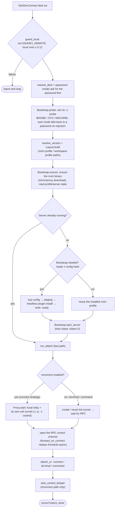
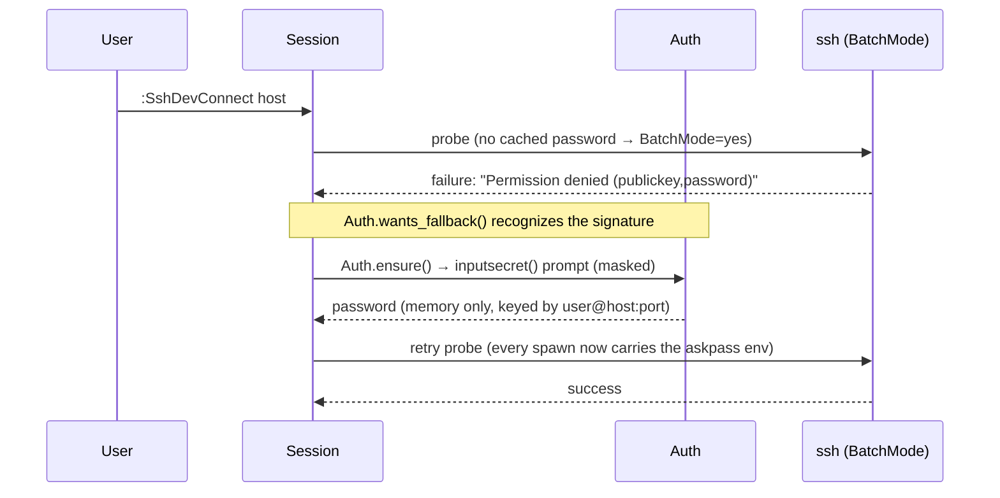

# sshdev.nvim Remote Connection — Technical Documentation

This document describes the complete technical implementation of the
**remote connection** subsystem in sshdev.nvim: how a local Neovim
establishes a development session on a remote host over SSH — destination
parsing, authentication, the remote state layout, and how the remote
headless server is attached to by the local UI.

Readers are expected to know the plugin's basic concepts
(workspace / nvim profile / workspace profile) from the repository
`README.md`. The `ssh -L` tunnel and `:SshDevForward` are covered
separately in the companion document
[docs/port-forwarding.md](port-forwarding.md).

---

## 1. Overview

A remote connection glues three components together:

```text
local nvim (UI client, attached via :connect)
    │  RPC over 127.0.0.1:<lport>
    ▼
ssh -N -L 127.0.0.1:<lport> → <dest> → 127.0.0.1:<rport>   ← detached tunnel process
    ▼
remote nvim --headless --listen 127.0.0.1:<rport>          ← server running in the workspace
```

With `reconnect = true` (the default) the UI does not attach to the tunnel
directly: a small local relay (`scripts/ui_proxy.lua`) owns the tunnel and
keeps the UI's RPC channel open across network drops (§ 8.6):

```text
UI client --:connect--> 127.0.0.1:<lport>  [relay]  <-- ssh -L ui + control --> remote
```

Key design decisions:

| Decision | Rationale |
| --- | --- |
| The remote server listens on `127.0.0.1`, reachable only through the SSH tunnel | The remote host never opens an inbound port; sshd's TCP forwarding is the only way in |
| The server is a **detached** `nvim --headless` | When the local UI goes away (`:detach`, closing the terminal, a crashed nvim) the server keeps running and the session survives |
| The remote nvim matches the local version exactly (`nvim_version = 'auto'`) | Session files and the RPC API stay compatible on both ends; version skew produces hard-to-debug behavior |
| The local config is uploaded wholesale into a **content-addressed** profile | The remote session behaves exactly like home; workspaces with the same config content share the profile and plugins are installed once |
| Every remote operation is `ssh -- dest sh -s` with the script on stdin | No client-side remote command line is ever assembled, eliminating the shell-quoting injection surface entirely |
| No `:q` hijacking | The server quits normally, writes `session.vim` on `VimLeavePre`, and the next connection restores it |
| The UI attaches through a local relay (`reconnect = true`) | A dropped RPC channel makes nvim's UI client exit (§ 8.6); the relay keeps the channel open and rebuilds the tunnel instead |

---

## 2. The two-level profile model

Remote state (default root `~/.sshdev.nvim`, config key `remote_root`) is
split into two independent levels:

```text
<remote_root>/
├── nvim-bins/<nvim-version>/                     shared nvim releases (per version)
│   ├── bin/nvim
│   └── .platform                                 OS/arch marker
├── nvim-profiles/
│   └── --<local-hostname>--<nvim-version>--<hash8>--/
│       ├── nvim-bin -> ../../nvim-bins/<version> relative symlink
│       ├── nvim-config/                          the uploaded config (as NVIM_APPNAME)
│       ├── xdg/share/  xdg/state/  xdg/cache/    isolated XDG data/state/cache
│       ├── nvim-version  config-hash  client-host metadata
│       └── .ready                                 install-complete marker (content = config hash)
└── workspace-profiles/
    └── --<local-hostname>--<workspace-path>--/
        ├── nvim-profile -> ../../nvim-profiles/<key>
        ├── nvim-profile.txt  workspace.txt  client-host
        ├── session.lua                           server-side session helper
        ├── session.vim  forward.txt  last_used
        └── server.pid  server.addr  server.log
```

- **nvim profile** (reusable): the key is
  `--<local hostname>--<nvim version>--<first 8 hex of the config content hash>--`.
  The key *is* the config identity: editing config content (changing the
  hash) creates a new profile; `touch`ing files does not. The local hostname
  participates in the key so two laptops sharing one remote account never
  cross-contaminate each other.
- **workspace profile** (one per `(client host, workspace)`): session and
  server runtime state (`session.vim`, `server.pid/addr/log`,
  `forward.txt`), plus a relative symlink to one nvim profile. Two
  workspaces can share a nvim profile while keeping independent buffers /
  window layouts.

**Reuse rule**: the expensive path — config upload + headless plugin
install — runs only when `<nvim-profile>/.ready` differs from the current
config content hash (or `:SshDevConnect!` forces it). A second workspace
with the same config skips it entirely.

Key derivation lives in `lua/sshdev/layout.lua` (pure, unit-testable) and
`lua/sshdev/keys.lua`; path safety is guaranteed by
`Util.sanitize_segment()` producing a single safe path segment.

---

## 3. Destination parsing

### 3.1 Accepted formats

`Util.parse_dest()` (`lua/sshdev/util.lua`) accepts:

| Form | Example | Meaning |
| --- | --- | --- |
| `host` | `myhost` | no user, no port (ssh default 22) |
| `user@host` | `me@myhost` | |
| `host:port` | `myhost:2222` | a purely numeric tail after `:` is a port |
| `user@host:port` | `me@myhost:2222` | |
| `host:path` | `myhost:~/proj` | a non-numeric tail is an scp-style path — the workspace |
| `user@host:port:path` | `me@myhost:2222:~/proj` | port first, then path |

Limitations (reported as explicit user-facing errors, never silently):

- IPv6 literals are not supported;
- a second `@` is rejected outright;
- the parsed result `{ user, host, port, path, dest }` carries `dest`
  **without** the port; use `Util.format_dest()` when the display string
  must keep it (history therefore stores the full `user@host:port`, so a
  reconnect never silently falls back to port 22).

### 3.2 Sources and precedence

`Session.resolve_dest()` (`lua/sshdev/session.lua`) resolves the first
argument of `:SshDevConnect [dest]` in this order:

1. a named destination from `setup({ remotes = ... })`
   (`:SshDevConnect work`);
2. a raw `[user@]host[:port][:path]` string;
3. fallback to the `setup({ host = ... })` default when neither is given.

Command completion (`complete_args` in `plugin/sshdev.lua`) mixes in
`remotes` names, `host`, remembered destinations, and the `--auth=` /
`--nvim-profile=` flags.

---

## 4. The connect pipeline

`:SshDevConnect [!] [dest] [workspace]` triggers `Session.connect()`.
The whole pipeline runs inside a coroutine started by `Proc.launch`
(see §5.3); any error thrown along the way is reported through
`Util.report_error` instead of disrupting nvim.



Step by step (source: `lua/sshdev/session.lua`):

1. **guard_local** — two gates:
   - refuses when `SSHDEV_REMOTE=1`: this nvim already *is* an sshdev
     remote server; nested sshdev sessions are not allowed;
   - requires local nvim ≥ 0.12 (`:connect` was added in 0.12; 0.11 only
     has `:detach`).
2. **prepare_probe** — resolves the destination; with `auth = 'password'`
   the password is requested **before** the first ssh round trip; the
   `auth = 'auto'` fallback happens inside the probe (§6.2).
3. **Bootstrap.probe** — runs POSIX sh on the remote, which reports
   `SSHDEV:HOME=…`, `SSHDEV:SYS=…`, `SSHDEV:MACHINE=…`, `SSHDEV:SH=ok`.
   A non-POSIX `sh` or a missing `$HOME` aborts with a clear error (the
   target is not a Linux/macOS host).
4. **resolve_version + Layout.build** — with `nvim_version = 'auto'` the
   installed release matches the local one exactly; a local dev build
   falls back to `nightly` with a warning. `Layout.build` then derives
   every remote path and the deterministic ports.
5. **Bootstrap.ensure** — makes sure the versioned nvim binary exists
   (downloaded via `download_mirror` / `proxy` with curl, unpacked with
   tar into `nvim-bins/<version>/` when needed) and **read-only** reports
   profile and server state (`NP_EXISTS`, `NP_READY_HASH`, `SERVER`,
   `PID`, `ADDR`, `SESSION`…). Unsupported CPU/OS, missing curl/tar and a
   bad archive each have a dedicated error message.
6. **apply_reuse** — an explicit `--nvim-profile=<key>` has three
   branches:
   - `own`: the requested key *is* the auto key — normal bootstrap;
   - `reuse`: the key exists and finished installing → used **as-is**,
     never uploaded over (that would break the "key = config content
     hash" invariant);
   - `fallback`: the key is missing or incomplete → warn and fall back to
     the auto profile.
7. **Fast path** — the server is already running: read the port from
   `server.addr` and go straight to `run_attach` (`:SshDevConnect!` stops
   the old server first and takes the full path instead).
8. **Cold path** — when `needs_bootstrap` (`.ready` ≠ config hash):
   `Bootstrap.prepare` (directories, symlinks, metadata, the mkdir lock
   slot) → `upload_helper` (uploads `scripts/remote_session.lua`) →
   `upload_config` (staged local config tree + `scp -C -r`) →
   `commit_profile` (atomic staging swap-in + headless install + `.ready`
   written last). Two concurrent connects to new workspaces serialize on
   the mkdir lock (waiting up to `timeouts.lock`), so plugins are never
   installed twice in parallel.
9. **start_server** — tries `rbase`, `rbase+1`, `rbase+2` in order
   (§7.2); only when all three fail is an error reported.
10. **run_attach** — with `reconnect = true` and the `connect` strategy,
    start the local relay (§8.6), verify the server through its control
    forward, open the control channel (§8.4), asynchronously replay the
    `forward.txt` forwards, attach the UI and start the control keeper;
    otherwise create/reuse the plain tunnel, wait for RPC reachability
    (§7.3), open the control channel, replay the forwards, attach the UI.
    Either way the connection is recorded in history.

How the commands map onto the pipeline:

| Command | Pipeline difference |
| --- | --- |
| `:SshDevConnect` | full pipeline; attach only when the server already runs |
| `:SshDevConnect!` | stop the server, force-resync the config into the profile, restart |
| `:SshDevAttach` | `reuse_only = true`: never bootstraps or restarts; errors when no server is running |
| `:SshDevInstall` | stops after `commit_profile`; no server, no attach |
| `:SshDevSync` | unconditionally re-uploads config + reinstalls plugins (an explicitly reused profile must not be overwritten — it switches to the auto profile with a warning) |

---

## 5. The SSH transport layer

Implemented in `lua/sshdev/ssh.lua` and `lua/sshdev/proc.lua`.

### 5.1 Options carried by every invocation

`base_args()` adds the following to every ssh/scp call:

| Option | Value | Purpose |
| --- | --- | --- |
| `ConnectTimeout` | `15` | bounded connect timeout, no hanging |
| `ServerAliveInterval` / `ServerAliveCountMax` | `15` / `3` | keepalives detect dead links (declared dead after ~45s) |
| `StrictHostKeyChecking` | `accept-new` | auto-accept a new host fingerprint on first connect, still reject a changed one (needs OpenSSH ≥ 7.6) |
| `BatchMode` | `yes` (conditional) | while the auto mode has no cached password, and always in key mode: strictly non-interactive. Without it, a password-needing ssh hangs on the prompt until the command timeout instead of **failing fast** with the `Permission denied` signature (the auto fallback depends on that fast failure) |
| `ssh_args` | user-defined | appended last, may override any default (e.g. `-i`, `Compression`) |

Ports are passed as `-p` (ssh) / `-P` (scp); a `--` separator always
precedes the destination.

### 5.2 The remote-script execution model

Every remote action (probe / ensure / prepare / commit / start / status /
stop / listings / the forward fetch) follows the same pattern:

```text
ssh <base args> -- user@host sh -s     ← the script is fed on stdin
```

- Script templates live in `lua/sshdev/remote_scripts.lua`;
  `Util.render()` substitutes `{{KEY}}` placeholders with values that
  passed `Util.shsafe()` — any value containing quotes, tabs or newlines
  throws on the client, never reaching the remote;
- every script is prefixed by `Ssh.script_prologue()` with

  1. the workspace's `env.txt` exports (`export KEY='value'`, see
     [environment.md](environment.md)), then
  2. the `remote_path_prepend` PATH augmentation
     (`Scripts.path_augment`, see §7.1 and [§10](#10-connection-related-configuration-reference)).

  The order is deliberate: an `env.txt` `PATH=` is the base and the
  configured tool directories are prepended on top of it;
- scripts report machine-readable `SSHDEV:KEY=VALUE` lines, parsed by
  `Util.parse_keyvals()`; listings use TAB-separated rows; the probe also
  reports the ssh shell's PATH after the `remote_path_prepend`
  augmentation (`SSHDEV:PATH=`), logged as `remote PATH: …`;
- the scripts themselves are `set -eu` POSIX sh with no bash dependency
  (the prologue runs before that, so it may itself handle an unset PATH).

### 5.3 Async primitives (proc.lua)

- `Proc.launch(fn)` runs the whole flow in a coroutine; job/libuv
  callbacks resume it through `vim.schedule` (jobstart callbacks run in
  a fast event context where nvim APIs are forbidden).
- `Proc.await{ cmd, input, env, timeout, ... }` waits for one
  `jobstart` child and returns `{ code, stdout, stderr, timed_out }`;
  timeouts kill the process.
- `Proc.sleep(ms)`, `Proc.await_tcp_probe` and `Proc.await_tcp_accept`
  are the remaining flow primitives (the crucial difference between the
  two TCP probes is covered in [port-forwarding.md](port-forwarding.md)).

### 5.4 scp uploads

`upload_file` / `upload_dir` call scp with a **relative source path +
`cwd`**, sidestepping the Windows ambiguity where scp treats `C:` as a
remote address. The remote destination path is passed **raw** (no shell
quoting): OpenSSH ≥ 9 scp defaults to the SFTP protocol, where the remote
path never goes through a remote shell — adding quotes actually makes
Windows' scp fail with
`realpath ...: No such file / path canonicalization failed`.

---

## 6. Authentication

Implemented in `lua/sshdev/auth.lua`. Three modes (globally via
`setup()`, or per invocation via `--auth=`):

| Mode | Behavior |
| --- | --- |
| `auto` (default) | try keys / ssh-agent fully non-interactively; on rejection ask for a password once and retry; the password is cached in memory for the rest of this nvim session |
| `password` | prompt before the first ssh call (for hosts known to be password-only — skips the doomed non-interactive round trip) |
| `key` | strictly non-interactive: never prompt, never inject askpass |

### 6.1 The auto-mode sequence



Key details:

- **Failure-signature detection**: `Auth.auth_failure_in()` matches
  `Permission denied (publickey,password,…)` — an ssh *connection-level*
  rejection (with the auth-method list) — and distinguishes it from a
  remote file-permission error (no method list), so "cannot read some
  file" is never mistaken for "the password was rejected".
- A rejected password is dropped immediately with `Auth.forget()`:
  `Ssh.run_script` / the `upload_*` functions and the tunnel's
  `on_exit` all clear the cache when they see the auth-failure
  signature, so the next connection asks again.
- A headless nvim (no UI) cannot prompt: the **original ssh error** is
  kept with an explanatory note instead of stalling on a prompt.
- Passwords are cached **per full destination including the ssh port**
  (`user@host:port`) — two ports of the same host are two entries.

### 6.2 The askpass mechanism

Once a password is in play, every ssh/scp/tunnel child receives an
environment overlay:

```text
SSH_ASKPASS=<stdpath('cache')>/sshdev/askpass.cmd|.sh
SSH_ASKPASS_REQUIRE=force
SSHDEV_PASS=<password>
DISPLAY=:0          (only when the outer env has no DISPLAY: legacy gate for < 8.4 clients)
```

- The helper script is **static**: it just `echo`es `$SSHDEV_PASS` and
  contains no secret itself, so keeping it in the cache directory is
  harmless; it is rewritten before each use (self-healing stale copies).
  The POSIX version is `chmod 0700` (ssh only executes askpass programs
  with the executable bit set).
- `SSH_ASKPASS_REQUIRE=force` (OpenSSH ≥ 8.4; the Windows inbox client
  since 8.6) lets terminal-less `jobstart` children and even detached
  `ssh -N -L` tunnels authenticate (verified against Windows OpenSSH
  9.5p2).
- A working key keeps working: ssh still tries keys first, the helper is
  consulted only when a password is actually needed.
- Windows cost: cmd's delayed expansion means a literal `!` in a password
  cannot be passed — warned at prompt time; passwords containing newlines
  are rejected outright.

**The declared security trade-off**: the password is visible in the
environment of every spawned ssh/scp child (including a tunnel that may
outlive nvim). 2FA / keyboard-interactive prompts cannot be answered (use
key auth for those). `:checkhealth sshdev` verifies the client capability
and the helper status.

---

## 7. The remote server

### 7.1 Startup shape

`Bootstrap.start_server` renders `Scripts.start`, which ultimately
executes on the remote:

```sh
# prepended by Ssh.script_prologue() (env.txt exports, then PATH augmentation):
# export KEY='value'                                  (env.txt)
# for _sshdev_dir in "$HOME"/'.cargo/bin' ...; do ... (remote_path_prepend)
cd <workspace>
export XDG_CONFIG_HOME=<nvim-profile>
export XDG_DATA_HOME=<nvim-profile>/xdg/share
export XDG_STATE_HOME=<nvim-profile>/xdg/state
export XDG_CACHE_HOME=<nvim-profile>/xdg/cache
export NVIM_APPNAME=nvim-config
export SSHDEV_REMOTE=1
export SSHDEV_NVIM_PROFILE=<nvim-profile>
export SSHDEV_WORKSPACE_PROFILE=<workspace-profile>
export SSHDEV_SESSION=<session.vim path or empty>
export SSHDEV_RESTORE=1|0

nohup <nvim-profile>/nvim-bin/bin/nvim \
  --headless --listen 127.0.0.1:<rport> \
  -c "luafile <workspace-profile>/session.lua" \
  </dev/null > <workspace-profile>/server.log 2>&1 &
```

All XDG variables are redirected into the profile: the config is exactly
`<nvim-profile>/nvim-config` and the plugins land in
`<nvim-profile>/xdg/share/nvim-config/` — never colliding with the remote
user's own nvim state.

**Remote PATH.** `ssh host sh -s` is a non-interactive, non-login shell: it
does not read `~/.bashrc` / `~/.profile`, so its PATH is the sshd default.
`cfg.remote_path_prepend` (default `~/.cargo/bin`, `~/.local/bin`, `~/bin`)
is prepended to it before the server starts, which is what makes a
`cargo install tree-sitter-cli` visible to nvim-treesitter, and LSPs /
formatters in `~/.local/bin` visible to the session. `Scripts.path_augment`
emits a POSIX fragment that adds only **existing** directories, keeps the
configured order and skips entries already on PATH. The same prologue feeds
the headless install run, so plugin post-install hooks see the PATH too.
The list can be disabled with `{}` and is not part of the config content
hash (changing it never reinstalls plugins).

The start script then **verifies the port actually accepts connections**
(up to 25 × 0.2s of polling; a dead process or a port that never listens
reports `SSHDEV:SERVER=dead` together with the tail of `server.log`),
and only then writes `server.pid`, `server.addr` and `last_used`.

### 7.2 Liveness detection (FIND_RUNNING)

Server liveness is driven by `server.pid` first (validated with
`kill -0` after reading); a lost or stale pid file falls back to
**command-line matching**:

```sh
pgrep -f -- "<workspace-profile>/session.lua"    # first living process
```

The `session.lua` path is unique per workspace and the server's command
line carries it (`-c "luafile <workspace-profile>/session.lua"`), so the
match is exact: a lost pid file never leads to a second server on the
same port (both the start and the status scripts write the found pid
back into `server.pid`, i.e. they *adopt* a running server).

### 7.3 Ports and tunnel hookup

- The remote listen port is
  `rport = 20000 + djb2('R:' .. user@host .. '/' .. ws-key) % 20000`,
  deterministically inside `[20000, 39999]`; when busy the start tries
  `rbase+1` and `rbase+2`.
- The local tunnel port `lport` uses the mirror formula (the `'L:'`
  prefix); see [port-forwarding.md](port-forwarding.md) §3.
- `run_attach` first probes whether `lbase` is already being served
  (probing a **real RPC connection held open for a 400ms settle window**,
  not merely "the port accepts a connect") — if so the existing tunnel is
  reused. Otherwise it finds a free port upward from `lbase` (up to 16
  attempts), starts a new tunnel, and polls for RPC reachability within
  `timeouts.attach` (default 30s). A tunnel that dies mid-flight fails
  immediately with ssh's own stderr tail attached.
- With `reconnect = true` (`connect` strategy) this section is owned by the
  relay instead: the relay picks a block of four adjacent ports from the
  same `lbase` (UI, tunnel, control, admin), probes them for collisions, and
  writes a `proxy-<token>.ready` marker once its listener is bound. The
  plugin then waits for the *control* forward and validates the server with a
  real RPC handshake before issuing `:connect`. § 8.6 has the state machine.

### 7.4 Session persistence

The remote `session.lua` (`scripts/remote_session.lua`, self-contained,
requiring no plugins) is responsible for exactly three things:

| When | What happens |
| --- | --- |
| server start (after `VimEnter`) | restore `session.vim` when `SSHDEV_RESTORE=1` and it exists |
| server exit (`VimLeavePre`) | write the session to `<workspace-profile>/session.vim` |
| after restore + when the first UI attaches | re-establish `FileType` on the restored buffers |

The FileType repair is mandatory: session sourcing loads buffer contents
but **suppresses the read events** (no `BufReadPost` → no filetype
detection), so without the repair the restored buffers would have no
syntax highlighting, LSP or treesitter. The repair has two parts: buffers
without a filetype get one via explicit `vim.filetype.match` detection
(assigning fires `FileType`); buffers that already have one get
`FileType` re-fired — lazy-loading plugin managers only register their
handlers when the first UI attaches.

Behavior summary (as implemented):

| Event | Result |
| --- | --- |
| `:q` / `:wq` / `:qa` / `SIGTERM` (`:SshDevStop`) | the server exits → writes `session.vim` |
| `FocusLost` / `VimSuspend` | best-effort snapshot |
| next `:SshDevConnect` | the server restarts and restores `session.vim` |

Configuration: `session = false` disables saving entirely;
`restore_session = false` saves but always starts clean.

---

## 8. UI attachment

### 8.1 Strategy selection

`attach = 'auto'` (the default) picks by UI kind:

| UI (`ui_kind()`) | Strategy | Action |
| --- | --- | --- |
| builtin TUI (the single UI on chan 1) | `connect` | `:connect 127.0.0.1:<lport>` re-attaches the terminal UI in place |
| external GUI (attached over an RPC channel) | `connect` | the GUI implements the `connect` UI event itself |
| headless (no UI) | `command` | just print `nvim --server … --remote-ui` |

`attach` can also be set explicitly: `'connect'` (forced),
`'terminal'` (a local terminal tab runs a separate UI client
`nvim --server <addr> --remote-ui`, leaving the local nvim alive after
quitting the remote session), or `'command'` (do not attach; print the
command).

With `attach = 'auto'`/`'connect'` and `reconnect = true` (the default), the
`connect` attach goes through the local reconnect relay described in § 8.6;
the target address passed to `:connect` is still a bare `127.0.0.1:<lport>`
(on the relay), so none of the attachment semantics change.

### 8.2 The `:connect` address-format trap

`:connect` accepts only a **bare `host:port`** (or the builtin
`ssh://…` form). A `tcp://host:port` URI is not a valid nvim server
address: the UI detaches first, the attach fails, and the process ends —
which looks exactly like "my nvim does not support `:connect`".
`guard_connect` produces a readable version error up front when the
`:connect` command is missing.

### 8.3 Post-attach-exit reporting (terminal strategy)

With `attach = 'terminal'`, the exit of the UI client inside the
terminal tab (`nvim --server … --remote-ui`) triggers
`report_after_ui_exit`. A detach and a real quit both exit with code 0
and cannot be told apart from the code, so it **re-checks the remote
server**: still running → the terminal window closes with a
"detached — `:SshDevAttach` returns" notice; stopped → the local session
state is cleared and the user is told the session was saved and
`:SshDevConnect` restores it.

(The `:connect` strategy has no such callback: in-place attach/detach is
handled by nvim's own attach machinery; exiting the local process simply
exits.)

### 8.4 The RPC control channel

Before attaching, the client opens a second RPC connection to the server
through the tunnel (`vim.fn.sockconnect('tcp', …, { rpc = true })`):

1. an `nvim_get_api_info` handshake retrieves the channel id under
   which the server sees us;
2. on the server it executes
   `_G.SSHDEV_CONTROL_CHANNEL = <our channel id>`;
3. from then on the **server side** can drive **client-side** actions via
   `rpcnotify → nvim_exec_lua` — even while the client UI is attached to
   the remote (the client is headless; the remote UI is the visible
   surface).

The client side uses the same channel for two runtime pushes before the UI
attaches: the workspace environment (`Env.push`, see
[environment.md](environment.md)) and the remote PATH
(`Ssh.push_remote_path` — a static Lua chunk that prepends the configured
`remote_path_prepend` directories to the running server's `vim.env.PATH`;
only directories that exist are added, deduplicated, order preserved).
The PATH push is what heals a server started **before** the option existed
(or before a tool directory appeared): `:TSInstall`, `:terminal` and jobs
started afterwards see the fixed PATH without a server restart, while
already-running LSPs keep their old environment.

Current use: when `:SshDevForward` runs inside an attached session, the
remote pushes the forward.txt save back to the client, which replaces the
forwards bound on its own machine and reports the outcome into the remote
UI (see [port-forwarding.md](port-forwarding.md) §7). Client-owned
commands do the same: `:SshDevStop`, `:SshDevStatus`, `:SshDevSync`,
`:SshDevInstall` and `:SshDevProfiles` are forwarded to the client, which
owns the tunnel, the profiles and the remote server process; its
notifications are mirrored into the attached UI through the same channel
(§ 8.4.1). The channel is best-effort: when unavailable the feature
degrades to `:detach` guidance.

#### 8.4.1 Client-owned commands (`:SshDevStop` & co.)

Typing `:SshDevStop` in the attached remote session must not run in the
remote server: there is no `state.info` there, so the old behavior was a
confusing "no active sshdev session" message and nothing was stopped. The
command layer forwards it instead:

```text
remote nvim (the UI the user drives)
   │  :SshDevStop → SSHDEV_CONTROL_CHANNEL
   │  rpcnotify(ch, 'nvim_exec_lua',
   │            'require("sshdev.session")._remote_command(name, opts)')
   ▼
client nvim (headless behind the attached UI)
   │  whitelist: SshDevStop / Status / Sync / Install / Profiles
   │  runs the normal public entry point (same code as the local command)
   │  Util message mirror → nvim_exec_lua on the remote UI
   ▼
remote UI: progress + result as `[sshdev]` notifications
```

- The whitelist is the security boundary: a remote cannot make the client
  run arbitrary functions or commands.
- `[dest] [workspace]` default to the **active session** for the commands
  that accept them, so `:SshDevSync` inside the attached UI means "this
  workspace".
- `Util.set_message_mirror` is installed **right after a successful
  `:connect`** (and re-installed by the keeper after a reconnect): while the
  client is headless, its own `vim.notify()` has no surface, and worse, a
  multi-line notification makes a headless nvim wait on an invisible
  "Press ENTER" prompt — that blocks the main loop and silently freezes the
  control channel. The mirror therefore **replaces** the local surface:
  `Util.notify`/`report_error` skip the local call while it is installed, so
  client-side messages (including failures) reach the remote UI without
  stalling the client. `Util.status()` lines go through `nvim_echo`
  (transient), everything else through `vim.notify`. A send failure is only
  logged (the message is still in `:SshDevLog`); the local path is never used
  as a fallback while attached.
- The remote acknowledges the forward immediately. A successful
  `:SshDevStop` closes the UI (the server is gone); if the stop fails the
  remote server keeps running and a 20 s safety timer warns the user to
  check the client's `:SshDevLog`.
- Connection/picker commands (`:SshDevConnect`, `:SshDevAttach`,
  `:SshDevHistory`) are **not** forwarded: a headless client cannot
  re-attach its UI (`:connect` fails with "UI not attached to channel").
  They report the `:detach` → run locally → `:SshDevAttach` workflow.

### 8.5 Local teardown (VimLeavePre)

`plugin/sshdev.lua` registers `VimLeavePre` →
`Session.teardown_local()`:

- skipped right after a successful `:connect` (`state.attached`) — the local
  nvim server is detached from the UI client by `:connect` and must keep
  running (the remote session and the reconnect relay depend on it), and the
  tunnel must survive that moment (the remote server keeps running, which is
  the point);
- otherwise the session tunnel it started is killed, the reconnect proxy
  stopped (gracefully, through its admin port), the control channel closed,
  and the user forwards stopped (`Forward.kill()`).

`:SshDevStop` is the explicit form: kill the tunnel, stop the proxy, close the
control channel, stop the forwards, `SIGTERM` the remote server (which saves
the session via `VimLeavePre`), and clear the local session state.

### 8.6 The reconnect proxy (`reconnect = true`)

**Why.** `:connect` hands the UI client's *server channel* to the remote
server. nvim's UI client treats EOF on that channel as "the server exited"
and calls `exit_on_closed_chan()`: the local nvim process exits. A Wi-Fi
flap, a VPN reconnect or a laptop suspend therefore looks exactly like a
crash.

**Shape.** With `reconnect` enabled the UI attaches to a local relay instead
of to the ssh tunnel:

```text
UI client --:connect--> 127.0.0.1:<lport>
                            │  scripts/ui_proxy.lua (detached headless nvim)
                            │    ssh -N -L <tunnel>:rport -L <control>:rport
                            ▼
                     remote nvim --headless --listen 127.0.0.1:<rport>
```

The relay owns the ssh tunnel and the UI's channel is the relay's listening
socket, which never closes. It is a transparent msgpack-RPC relay: bytes from
the UI are forwarded upstream and vice versa. Two things are not transparent:

1. `nvim_ui_attach` (and `nvim_set_client_info`) are **captured** from the UI
   stream and replayed on every new upstream connection. The remote server
   sees a fresh UI attach and sends a full screen; the local UI just receives
   a normal redraw on its unchanged channel.
2. `nvim_input`/`nvim_paste` are dropped while the upstream is down, so a
   key typed against a frozen screen cannot execute minutes later.

**State machine.**

| Event | Action |
| --- | --- |
| startup | bind `lport` (write the plugin's readiness marker), spawn the ssh tunnel, connect the upstream forward |
| upstream EOF, ssh process still alive | the remote server closed the UI channel (`:q`, `:detach`, crash): close the UI channel so the local UI exits; stop the tunnel |
| upstream EOF, ssh process died | network drop: keep the UI channel open, retry the tunnel/upstream with exponential backoff (1 s → 30 s), resend the captured attach once connected |
| tunnel bind failure on the first attempt | the plugin's port guess collided: exit so the plugin retries with a different port block |
| ssh auth failure | cannot prompt from the relay: exit, the local UI exits; the next connect asks again |
| UI channel EOF | the local UI went away: stop the tunnel and exit, reaping the detached local nvim server (`parent_pid`) so no headless orphan is left |
| admin port connection | the plugin is tearing the relay down on purpose: stop the tunnel and exit without reaping the parent |

**Companions.** The relay's tunnel also forwards the RPC control channel
(§ 8.4) on a second local port. The local nvim server — headless after
`:connect` but still alive — runs a small keeper that notices the dead control
channel, re-opens it when the relay's tunnel is back, re-pushes `env.txt` and
re-applies `forward.txt`, then echoes `[sshdev] reconnected to …` into the
attached remote UI. The reader is § 8.4; the keeper lives in
`session.lua:start_control_keeper`.

**Limits.** Detection is bounded by ssh's own keepalives
(`ServerAliveInterval=15`, `ServerAliveCountMax=3` → up to 45 s); a reset
connection is detected immediately. Only the link is rebuilt: if the remote
server itself stopped, the local UI exits (there is nothing to reconnect to).
The `terminal` strategy has its own UI client and is not supervised.
`reconnect = false` restores the direct `:connect` behaviour.

**Local artifacts.** One `proxy-<token>.log` and, during startup, a
`proxy-<token>.ready` marker under `stdpath('cache')/sshdev/`; the log is
reported when the relay cannot start. Ports come from
`Util.local_port(dest, workspace_key)` and are probed for collisions; a
successful start logs the four ports (UI, tunnel, control, admin).

---

## 9. Commands and the Lua API

Connection-related user commands (defined in `plugin/sshdev.lua`,
everything lazy-loads):

| Command | Purpose |
| --- | --- |
| `:SshDevConnect [!] [dest] [ws] [--auth=…] [--nvim-profile=…]` | full pipeline; `!` force-resyncs and restarts; no arguments opens the picker |
| `:SshDevAttach [dest] [ws]` | attach to an already-running server only |
| `:SshDevInstall [dest] [ws]` | bootstrap only (binary + config + plugins); no server |
| `:SshDevSync [dest] [ws]` | re-upload the config and reinstall plugins |
| `:SshDevStop` | stop the remote server (saves the session) + local tunnel/forwards |
| `:SshDevStatus` | report local nvim, session, tunnel, remote server, forwards, history |
| `:SshDevHistory [dest]` | remote workspace picker (filtered by this machine's hostname) |
| `:SshDevProfiles [dest]` | list reusable nvim profiles on the remote |
| `:SshDevLog` | open the log buffer |
| `:checkhealth sshdev` | verify the local + remote environment (incl. askpass capability) |

Argument rules: `--nvim-profile=<key>` (also `--nvim-profile <key>` /
`-p`) pins an explicit profile; `--auth=auto|password|key` overrides the
auth mode for one invocation; at most two positional arguments
(destination, workspace). History entries keep the **full destination
including the ssh port**.

`:SshDevStop`, `:SshDevStatus`, `:SshDevSync`, `:SshDevInstall` and
`:SshDevProfiles` also work when typed **inside the attached remote
session**: they are forwarded to the client and execute there (§ 8.4.1).
`:SshDevConnect`, `:SshDevAttach` and the pickers cannot (a headless
client cannot re-attach its UI) and tell the user to `:detach` first.

Lua API (`require('sshdev')`): `connect` / `attach` / `pick` /
`pick_history` / `profiles` / `install` / `sync` / `stop` / `status` /
`history` / `log` — mirroring the table above (`forward` is covered in
the port-forwarding document).

---

## 10. Connection-related configuration reference

`require('sshdev').setup({ … })` (validation in `lua/sshdev/config.lua`):

| Key | Default | Meaning |
| --- | --- | --- |
| `host` | nil | default destination `[user@]host[:port]` |
| `remotes` | `{}` | named destinations, usable as command arguments |
| `workspace` | nil (remote `$HOME`) | default remote project dir; must be absolute or `~/`-relative |
| `workspace_profile` | nil | force the workspace profile directory name (single path segment) |
| `nvim_profile` | `'auto'` | `'auto'`, or an explicit profile key to reuse |
| `remote_root` | `'~/.sshdev.nvim'` | remote state root |
| `nvim_version` | `'auto'` | `'auto'` / `'vX.Y.Z'` / `'nightly'` / `'stable'` |
| `ssh_bin` / `scp_bin` | `'ssh'` / `'scp'` | binaries |
| `ssh_args` | `{}` | appended to every ssh/scp invocation |
| `auth` | `'auto'` | auth mode (see §6) |
| `proxy` | nil | proxy URL used **on the remote** for the nvim download |
| `download_mirror` | GitHub releases | base URL for nvim downloads |
| `install_commands` | `{}` | extra ex-commands after the headless install (e.g. `'Lazy! restore'`) |
| `excludes` | `{ '.git', '.github' }` | upload-exclude globs; part of the content hash |
| `remote_path_prepend` | `{ '~/.cargo/bin', '~/.local/bin', '~/bin' }` | directories prepended to the remote PATH of the server and every remote script; only existing dirs are added, `{}` disables |
| `session` / `restore_session` | `true` / `true` | session save / restore switches |
| `attach` | `'auto'` | attach strategy (§8.1) |
| `reconnect` | `true` | keep the UI alive across network drops through the local relay (§8.6); `false` = direct `:connect` |
| `history` / `history_limit` | `true` / `50` | connection history and its cap |
| `timeouts.*` | `60` etc. | ssh 60 / download 600 / install 900 / attach 30 / lock 120 (seconds) |

`forward_on_connect` concerns port forwarding — see
[port-forwarding.md](port-forwarding.md).

---

## 11. Troubleshooting

| Symptom | Common cause | Fix |
| --- | --- | --- |
| `sshdev.nvim needs Neovim >= 0.12 locally` | local nvim too old, no `:connect` | upgrade local Neovim |
| `the remote host did not run POSIX sh` | the target is not Linux/macOS (router, Windows target, …) | pick another target or prepare the environment manually |
| `Permission denied (publickey,…)` keeps appearing | key mode, or the password was rejected and the cache was already cleared | use `--auth=password` to prompt directly, or set up keys |
| auto mode takes very long before reporting an auth failure | password-only host with a client < 8.4 (no `SSH_ASKPASS_REQUIRE`) | upgrade OpenSSH or use key auth |
| `the remote platform … has no official nvim release` | unsupported architecture | install ≥ 0.12 manually on the remote and pin `nvim_version` |
| server start reports `SSHDEV:SERVER=dead` | workspace path missing/unwritable, port busy | check `<workspace-profile>/server.log` (the error carries the path) and `:SshDevLog` |
| tunnel is up but RPC never answers | remote `AllowTcpForwarding no`, firewall | make sure sshd allows TCP forwarding |
| the process ends right after `:connect` | the address was written `tcp://host:port` | use a bare `host:port` (§8.2) |
| nvim exits when the network blips | `reconnect = false`, or the channel was attached outside the relay | leave `reconnect` enabled (§8.6); a direct `:connect` channel exits the UI client on EOF by design |
| the screen is frozen after the network came back | the relay is rebuilding the tunnel; the title says "reconnecting…" | wait (ssh may take up to 45 s to notice a dead link); `:SshDevLog` + `stdpath('cache')/sshdev/proxy-*.log` show the attempts |
| the local nvim exited during a drop | the remote server itself stopped (or auth failed) — the relay only rebuilds the link | reconnect normally with `:SshDevConnect`; the session is restored from `session.vim` |
| the second workspace connects suspiciously fast | normal: the nvim profile is reused by content hash | confirm via `:SshDevLog` that no install phase ran |
| nvim-treesitter reports `ENOENT ... (cmd): 'tree-sitter'`, or an LSP/formatter is "not executable" | `ssh host sh -s` does not read `~/.bashrc` / `~/.profile`, so the tool's directory is not on the remote PATH | add it to `remote_path_prepend`, check the `remote PATH:` line in `:SshDevLog`, reconnect (`:SshDevConnect!` for a server started before the fix) |
| parser build fails with `Failed to execute the C compiler ... clang.exe` | the uploaded config sets a client-only `CC`/`CXX` (the same config runs on the remote host) | guard platform-specific `vim.env` assignments with `vim.fn.has('win32') == 1` (or `vim.env.SSHDEV_REMOTE == '1'`) |

General tools: `:SshDevLog` (in-memory mirror + buffer), `:SshDevStatus`,
the remote `<workspace-profile>/server.log`, `:checkhealth sshdev`.

---

## 12. Source index

| Module | Responsibility |
| --- | --- |
| `lua/sshdev/init.lua` | public Lua API; lazy telescope extension registration |
| `lua/sshdev/config.lua` | defaults, merging, validation |
| `lua/sshdev/session.lua` | connect pipeline orchestration, attach strategies, reconnect proxy attach path, control channel + keeper (env/PATH pushes, forward replay), teardown |
| `lua/sshdev/proxy.lua` | starts/stops the local reconnect relay, picks its ports, waits for readiness |
| `lua/sshdev/proxy_proto.lua` | pure msgpack framing + UI-event helpers used by the relay |
| `scripts/ui_proxy.lua` | the standalone reconnect relay (transparent RPC relay + ssh tunnel owner) |
| `lua/sshdev/layout.lua` | two-level profile path derivation (pure functions) |
| `lua/sshdev/keys.lua` | profile key generation and validation |
| `lua/sshdev/bootstrap.lua` | client-side remote orchestration: probe / ensure / prepare / commit / start / stop / status / listings |
| `lua/sshdev/remote_scripts.lua` | all remote POSIX sh script templates, the PATH augmentation fragment + output parsers |
| `lua/sshdev/ssh.lua` | ssh/scp argument construction, script prologue (env + PATH), script execution, runtime PATH push, tunnel spawning |
| `lua/sshdev/auth.lua` | auth modes, password cache, askpass helper, failure detection |
| `lua/sshdev/proc.lua` | coroutine async primitives, TCP probes |
| `lua/sshdev/util.lua` | destination parsing, hashing, ports, logging, config staging |
| `lua/sshdev/history.lua` | local connection history and cached remote profile keys |
| `lua/sshdev/picker.lua` / `lua/telescope/_extensions/sshdev.lua` | connection/history pickers (telescope optional) |
| `lua/sshdev/health.lua` | `:checkhealth sshdev` checks |
| `scripts/remote_session.lua` | the session-persistence helper uploaded to the remote |
| `plugin/sshdev.lua` | `:SshDev*` command definitions, argument parsing and completion |
